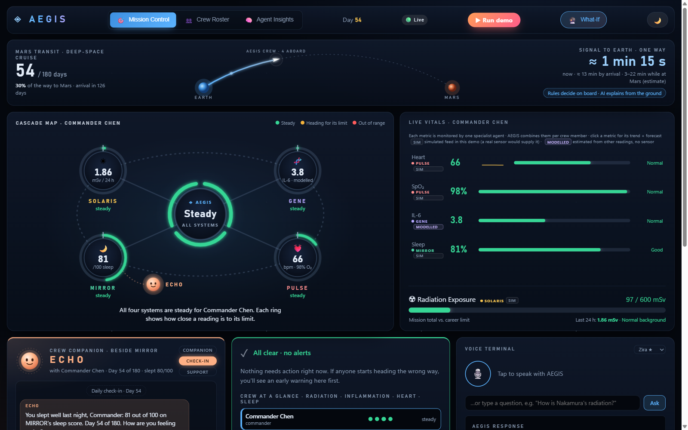
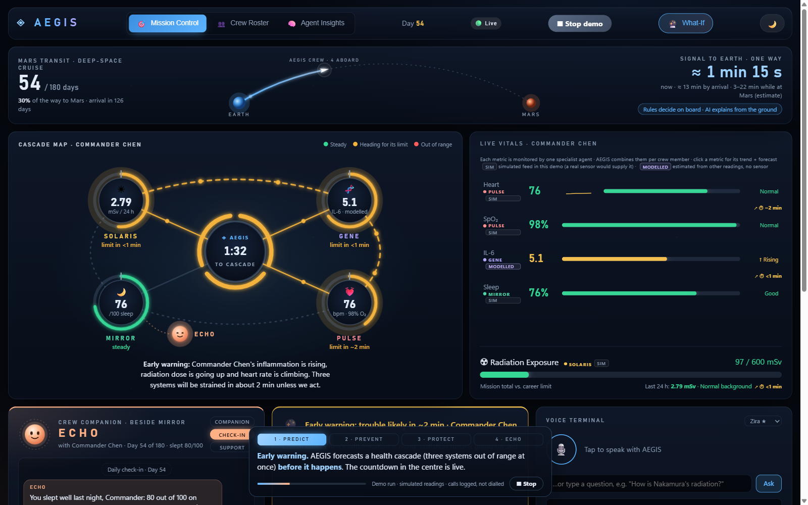
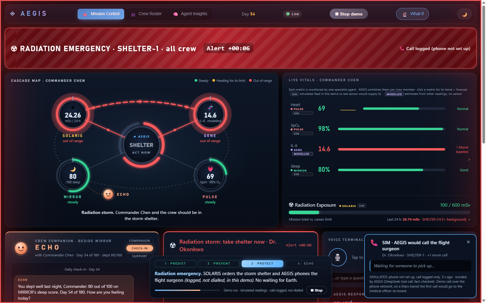
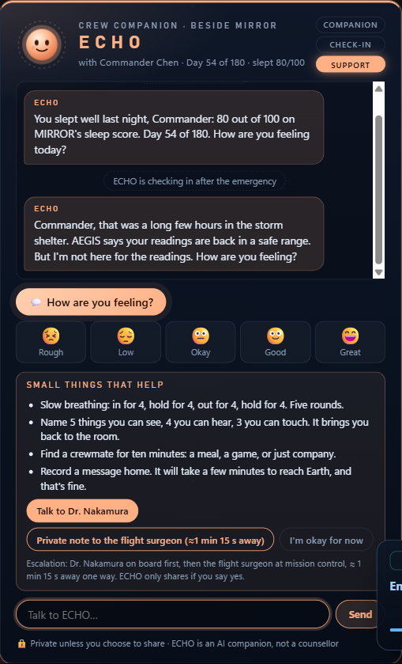
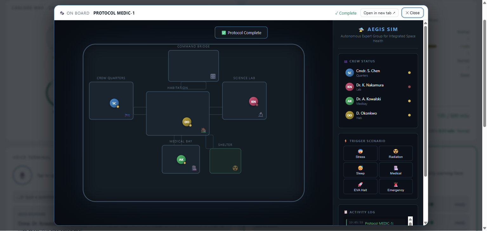

# AEGIS - Autonomous Expert Group for Integrated Space Health

**NASA Space Apps Challenge 2026 · Create Health Monitoring Software for Astronauts on Space Missions**

A multi-agent system that monitors crew health on deep-space missions, where help from Earth is minutes away.
Four specialist agents watch one area each, and AEGIS combines them to **predict** problems before they
happen, **prevent** them with early countermeasures, and **protect** the crew with emergency protocols.
**ECHO**, a crew companion, looks after the person as well as the readings: isolation is one of the hardest
parts of a Mars mission.

> **Prototype, not a medical device.** Vitals come from a simulator (no wearable hardware is connected),
> IL-6 is modelled from stress and radiation, and nothing here is clinically validated. See
> `artifacts/AEGIS-Accuracy-Report.html` for how the rules and the AI were tested against real NASA data.

---

## Screenshots

**Mission control (normal state): the Mars-transit header, the Cascade Map with ECHO beside MIRROR, live vitals**



| Early warning: AEGIS predicts a cascade before it happens | Radiation emergency: storm shelter for the whole crew |
|---|---|
|  |  |

| ECHO checks in after the emergency | On board: the protocol carried out in the spacecraft |
|---|---|
|  |  |

---

## The agents

| Agent | Watches | Raises |
|---|---|---|
| **AEGIS** | Combines the four specialists for each crew member | Predicted cascade (3+ systems heading out of range), cascade alert, protocol choice |
| **PULSE** | Heart rate, blood oxygen (SpO₂) | Fast/slow heart rate, low oxygen → medical response (MEDIC-1) |
| **GENE** | Inflammation signal (IL-6, **modelled** from stress + radiation, no blood sensor) | IL-6 at ≥ 1.5× the crew member's own pre-flight baseline (and +1.5 pg/mL), or > 12 pg/mL |
| **MIRROR** | Sleep quality | Fair / poor sleep |
| **SOLARIS** | Radiation dose (24 h and mission total) against the mission's normal background | ≥ 2× background = elevated; ≥ 5× background and ≥ background + 5 mSv = storm shelter (SHELTER-1) |
| **ECHO** | The person: how they say they feel, in a chat and a daily check-in (companion, not a monitor) | Support mode after an emergency, poor sleep (from MIRROR), a low check-in or distress in the chat; points to the medical officer first. Not counted as a cascade system |

### ECHO, the crew companion

MIRROR detects, ECHO responds. ECHO sits beside MIRROR on the Cascade Map and has its own panel with a friendly
avatar, a chat window and a **How are you feeling?** button. It has three modes, chosen by rules
(`aegis_echo.py`):

- **Companion** - talk to ECHO about anything. Warm, short replies; DeepSeek may word ordinary replies (role only,
  no names, checked for numbers and medicines), with scripted replies when it is off.
- **Check-in** - the daily greeting uses the person's real readings ("You slept well last night, Commander: 80
  out of 100"), then asks how they feel (rough / low / okay / good / great).
- **Support (crisis)** - after an emergency, when MIRROR flags poor sleep, after a low check-in or when the chat
  shows distress, ECHO checks in on its own, offers coping steps and the escalation path. Support replies are
  always scripted.

**Escalation follows the light delay:** the crew medical officer on board first (Dr. Nakamura; the Commander when
it is Dr. Nakamura who is struggling), then the flight surgeon at mission control, a signal delay away.
**Private by default:** check-ins and chats live only in memory, are never logged or sent to the ground, and ECHO
asks before sharing anything. The one exception, stated in the panel: if someone says they might harm themselves,
ECHO alerts the medical officer. ECHO always says it is an AI and is not a counsellor.

**The three pillars**

1. **PREDICT** - a least-squares trend over the last ~2 minutes of each reading forecasts when it will cross its
   agent's limit (`aegis_trends.py`). Three systems forecast to cross = an early cascade warning with a countdown.
   **Scope:** the demo compresses a cascade into a 6-minute build-up, and AEGIS warns about 2-3 minutes before
   the third system crosses. On a real mission the same method would run on hours-to-days data; that is not yet
   validated.
2. **PREVENT** - a prevention plan (PREVENT-1) and rule-approved recommendations, worded by DeepSeek and
   grounded in NASA sources (RAG over ChromaDB).
3. **PROTECT** - live alerts with one-click protocols: RECOVER-3 (cascade), SHELTER-1 (radiation storm),
   MEDIC-1 (medical emergency), shown on board in the 2D spacecraft simulation.

**Mission profile** (`aegis_mission.py`, set with `AEGIS_MISSION`): Mars transit by default, with a normal
background of 1.84 mSv/day measured by Curiosity RAD on its cruise to Mars, so SOLARIS warns at 3.68 and orders
the shelter at 9.2 mSv per 24 h. Profiles for the Mars surface (0.64), lunar surface (1.37) and ISS (0.5) are
included. NASA limits used: 600 mSv career, 250 mSv per solar particle event. GENE's pre-flight IL-6 baselines are
seeded inside the Inspiration4 crew's real pre-flight range (2.5-5.9 pg/mL, NASA OSDR OSD-575).

**What is real and what is simulated** - the dashboard tags each reading: **SIM** = simulated feed in this demo
(a wearable or dosimeter would supply it), **MODELLED** = estimated from other readings. The recovery after
PREVENT-1 in the build-up demo is scripted and labelled as such.

## The dashboard at a glance

| Feature | What it does |
|---|---|
| **Mission header** | The ship's position on the Earth-Mars transfer arc, the mission day and the one-way signal delay to Earth (about 1 min 15 s on day 54, about 13 min by arrival, 3-22 min at Mars), with a pulse travelling back to Earth. It turns into the emergency banner during an alert. |
| **Cascade Map** | The four specialists around AEGIS for one crew member. Each ring fills as a reading approaches its agent's limit; when a system starts to strain, a pulse fires from it into AEGIS and its neighbours, and comets flow along links where strain is spreading. The centre counts down to a predicted cascade (three systems out of range together). ECHO rides beside MIRROR. |
| **Live Vitals** | Heart rate, oxygen, modelled IL-6, sleep and radiation for the selected person, tagged SIM or MODELLED; click a reading for its trend and forecast. |
| **ECHO** | The crew companion: chat, daily check-in and support mode (see above). |
| **Alerts and crew at a glance** | The live alert with its one-click protocol, or, when all is clear, one row per crew member with a dot per system. |
| **Voice Terminal** | Ask any agent a question by voice or text; it answers from the live readings, in its own voice. |
| **Recommendations** | Rule-approved PREVENT actions, worded by DeepSeek, fact-checked, with sources; accept, defer or dismiss. |
| **Real NASA Data** | The datasets behind the numbers (Inspiration4 IL-6, Curiosity RAD and Chang'e-4 radiation, NASA limits and risks), each with its source link and the result of testing the rule against it. |
| **What-If simulator** | Sliders for hypothetical readings (heart rate, oxygen, IL-6, sleep, 24 h radiation) for the selected crew member. The real agent rules judge them exactly as they would live and say which protocol AEGIS would choose; nothing is saved and no alert is raised. |
| **Run demo** | One click plays the story end to end in 2 minutes (the judging cut; Shift+click, or `?demo=full` in the URL, for the full 3-minute version), with chapter captions and a Stop button: radiation creeps up, AEGIS predicts a cascade, the prevention plan avoids it, a solar storm forces the storm shelter, and ECHO checks in on the Commander afterwards. Calls are logged, never dialled, during the run. |
| **Spacecraft simulation** | A 2D view of the ship that shows a confirmed protocol being carried out on board. |
| **Phone alarm** | On critical alerts AEGIS phones the on-call flight surgeon (Twilio) and shows the call live on screen. |

**Keeping the AI honest** - the rules decide *when* to act; DeepSeek only explains and words the advice.
Every AI recommendation is fact-checked by `aegis_verify.py` (numbers, citations, approved actions, no
invented medicines) before it is shown; if it fails twice the card shows the rule-based advice instead.
Crew names are never sent to the model.

---

## Quick start (Windows)

### Prerequisites
- Python 3.10+ (3.13 used in development)
- Optional: [uv](https://docs.astral.sh/uv/getting-started/installation/)

### 1. Install

```powershell
cd path\to\project-horizons-AEGIS-nasa-apps-challeng
python -m venv .venv
.venv\Scripts\activate
pip install -r requirements.txt
```

(or `uv sync`)

### 2. Configure

```powershell
copy .env.example .env
```

Then edit `.env` (see [Configuration](#configuration)). Everything works without keys, using rule-based answers.

### 3. Start the backend

```powershell
$env:PYTHONUTF8 = "1"        # the startup log prints emoji; avoids a Windows console encoding error
uvicorn main:app --host 127.0.0.1 --port 8000
```

- API docs: http://127.0.0.1:8000/docs
- Health check: http://127.0.0.1:8000/health

The first start loads the embedding model and the knowledge base (about 20-40 s).

### 4. Serve the dashboard

In a second terminal, **from the project folder** (a new terminal usually opens in your home folder, and
serving the wrong folder gives a 404):

```powershell
cd path\to\project-horizons-AEGIS-nasa-apps-challeng
python -m http.server 8080 --bind 127.0.0.1
```

Open **http://127.0.0.1:8080/aegis-mission-control.html** (port **8080**, with the file name). Port 8000 is the
API only: http://127.0.0.1:8000 returns a JSON status, not the dashboard. The header shows **🟢 Live** when the backend is
connected and **🔴 Offline** when it isn't. Click anywhere once so the browser allows the agents' voices.

### Demo shortcuts (on the dashboard)

The quickest way to see everything: click **▶ Run demo · 2 min** in the header (Shift+click for the full 3-minute version; phone calls logged,
never dialled). Click **■ Stop** to end it early.

| Keys | Scenario |
|---|---|
| **Shift + B** | Slow build-up for the selected crew member → early warning, countdown, then "Start prevention plan" |
| **Shift + D** | Cascade for the selected crew member → recovery plan |
| **Shift + M** | Medical emergency (low oxygen) for the selected crew member → medical response |
| **Shift + S** | Solar storm for the whole crew → storm shelter |
| **Shift + N** | Back to normal |
| **Shift + R** | Clean demo reset: clears alerts, recommendations and history, crew back to their fixed baselines |

Before a rehearsal or recording, reset with **Shift + R** (or `python reset_demo.py`). Crew baselines are
fixed and the simulator is seeded, so the same scenario plays out the same way every time.

---

## Configuration

`.env` (never commit it; it is in `.gitignore`):

```bash
# DeepSeek: agents' explanations, Voice Terminal answers, RAG recommendations
DEEPSEEK_API_KEY=
DEEPSEEK_MODEL=deepseek-flash
# AEGIS_LLM=off               # force rule-based mode

# Phone alarm (optional, Twilio): AEGIS phones the on-call flight surgeon on critical alerts
TWILIO_ACCOUNT_SID=
TWILIO_AUTH_TOKEN=
TWILIO_FROM_NUMBER=           # your Twilio number, e.g. +1...
AEGIS_ONCALL_NUMBER=          # the phone to ring (on a trial account it must be verified)
# AEGIS_CALLS=off             # turn calls off without removing the keys
# AEGIS_CALL_COOLDOWN_MIN=10
# AEGIS_CALL_MAX_PER_HOUR=4
```

Without Twilio keys the alarm is logged ("would have called") instead of dialled. Test it with
`POST /api/notify/test` in the API docs.

---

## Project structure

```
project-horizons-AEGIS-nasa-apps-challeng/
├── main.py                       # FastAPI backend (all routes under /api)
├── agents.py                     # PULSE, GENE, MIRROR, SOLARIS + AEGIS coordinator
├── aegis_trends.py               # PREDICT: trends, time-to-limit forecasts, predicted cascade
├── aegis_llm.py                  # DeepSeek client (chat + tool calling), agent personas
├── aegis_verify.py               # Fact checker for AI output (numbers, citations, actions, medicines)
├── aegis_notify.py               # Phone alarm (Twilio voice call) + call_flight_surgeon tool
├── aegis_echo.py                 # ECHO crew companion: companion / check-in / support modes, private by default
├── aegis_rag.py                  # Knowledge-base retrieval (ChromaDB, all-MiniLM-L6-v2)
├── simulator.py                  # Vitals simulator and demo scenarios
├── database.py                   # SQLite storage (aegis.db, created on first run)
├── models.py                     # Pydantic models
├── setup_chromadb.py             # Builds the knowledge base into chroma_db/
├── aegis-mission-control.html    # Dashboard (Cascade Map, vitals, voice terminal, alerts, recommendations)
├── aegis-api-client.js           # Dashboard ↔ backend client
├── aegis-spacecraft-sim-2d.html  # 2D spacecraft: protocols carried out on board
├── chroma_db/                    # Vector database (knowledge base)
├── data/
│   ├── aegis_knowledge_base.json # Countermeasures, protocols, medications
│   ├── nasa_hrr_risks.json       # NASA Human Research Roadmap risks
│   ├── AEGIS_SOURCES.md          # Cited sources
│   ├── hrp_docs/  live_feeds/  osdr_metadata/
│   └── real/                     # Inspiration4 blood data (NASA OSDR OSD-575/569) + NTRS abstracts
├── eval/                         # Accuracy evaluation (run_eval.py, results.json)
└── artifacts/                    # Reports: accuracy, test plan, improvements, architecture, solution brief
```

---

## Main API endpoints

All under `http://127.0.0.1:8000`. Full list and try-it-out at `/docs`.

| Method | Endpoint | What it does |
|---|---|---|
| GET | `/health` | Backend, simulator and AI status |
| GET | `/api/crew` · `/api/crew/{id}` | Crew members and live vitals |
| GET | `/api/crew/{id}/trends` | Trends and time-to-limit forecasts for one person |
| GET | `/api/predict` | Forecasts and predicted cascades for the whole crew |
| POST | `/api/crew/{id}/prevent` | Start the prevention plan |
| GET | `/api/recommendations/pending` | Open recommendations (with fact-check result) |
| POST | `/api/recommendations/{id}/action` | Accept, defer or dismiss |
| GET | `/api/alerts` · POST `/api/alerts/{id}/acknowledge` | Alerts and confirming a protocol |
| POST | `/api/ask` | Ask an agent a question (Voice Terminal) |
| POST | `/api/whatif` | Run the agents on hypothetical readings |
| POST | `/api/query` | Search the knowledge base |
| POST | `/api/demo/reset` | Clean, repeatable demo start |
| POST | `/api/simulation/scenario/{name}` | Demo scenarios (`buildup_demo`, `cascade_demo`, `medical_emergency`, `spe_event`, `nominal`) |
| GET | `/api/notify/status` · POST `/api/notify/test` | Phone alarm status and a test call |
| GET | `/api/llm/status` | DeepSeek status (never shows the key) |
| GET | `/api/echo/{id}` | ECHO's mode for one person and the line it opens with |
| POST | `/api/echo/{id}/checkin` · `/chat` · `/share` · `/dismiss` | Check-in (mood 1-5), talk to ECHO, share only on a yes, leave support mode |
| POST | `/api/demo/story/start?cut=short\|full` · `/api/demo/story/stop` | The one-click story demo: 2-minute or full cut (compressed build-up, calls logged, not dialled) |

---

## Accuracy evaluation

```powershell
python eval\run_eval.py            # rules vs real data + DeepSeek grounding (uses the API)
python eval\run_eval.py --no-llm   # rules vs real data only
```

It replays real Inspiration4 IL-6 values through GENE, measured ISS / Mars radiation through SOLARIS and
clinical cut-offs through PULSE, then measures how often DeepSeek's output is grounded and how many planted
hallucinations the fact checker catches. Results: `eval/results.json` and `artifacts/AEGIS-Accuracy-Report.html`.

The October 2026 run fixed the two gaps the first run found: SOLARIS now judges dose against the mission
background (8/8 measured environments and regression cases correct, up from 3/8), and GENE uses a personal
baseline (3/4 real Inspiration4 post-flight rises detected, up from 0/4, with 1/12 pre-flight false alarms).

---

## Troubleshooting

- **404 when opening the dashboard** - the page server was started from the wrong folder, or the URL is wrong.
  Stop it, `cd` into the project folder (the one that contains `aegis-mission-control.html`), start
  `python -m http.server 8080 --bind 127.0.0.1` again, and open
  http://127.0.0.1:8080/aegis-mission-control.html. Opening http://127.0.0.1:8000 shows the API status, not the
  dashboard.
- **Dashboard shows 🔴 Offline** - the backend isn't running on port 8000, or the page was opened as a file.
  Serve it over http (step 4).
- **`UnicodeEncodeError` on startup** - set `$env:PYTHONUTF8 = "1"` before starting the backend.
- **Port 8000 in use** - `netstat -ano | findstr :8000`, then `taskkill /PID <pid> /F`.
- **No voice** - click the page once (browsers block speech until you interact); pick a voice in the Voice
  Terminal if the list is empty.
- **Knowledge base errors** - rebuild it: `python setup_chromadb.py`.

---

## License

NASA Space Apps Challenge 2026 - open source.
