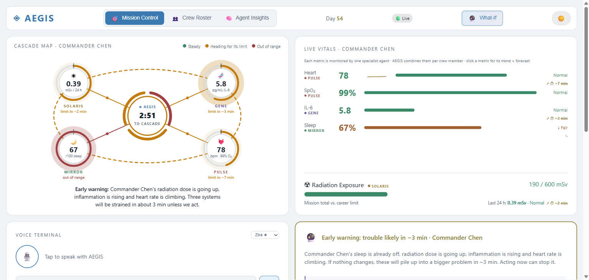
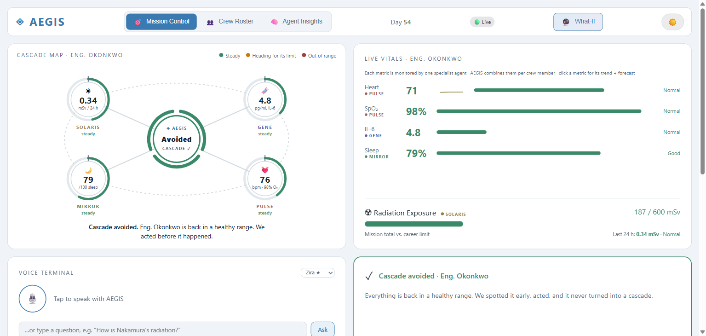
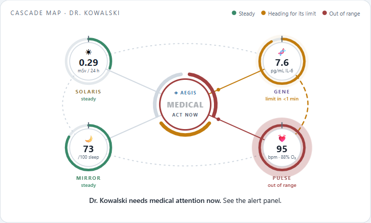
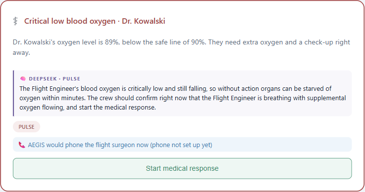
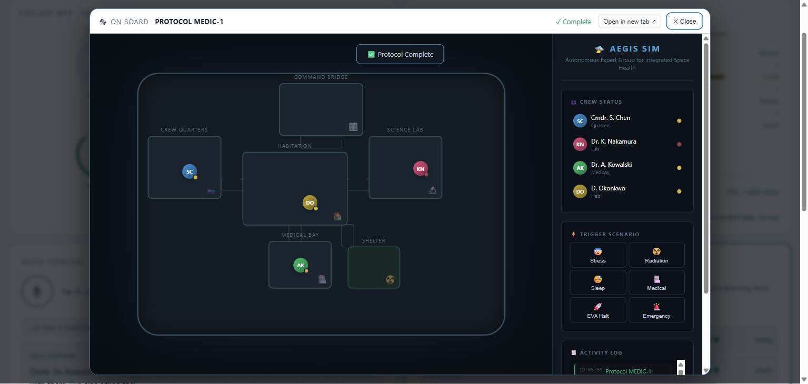
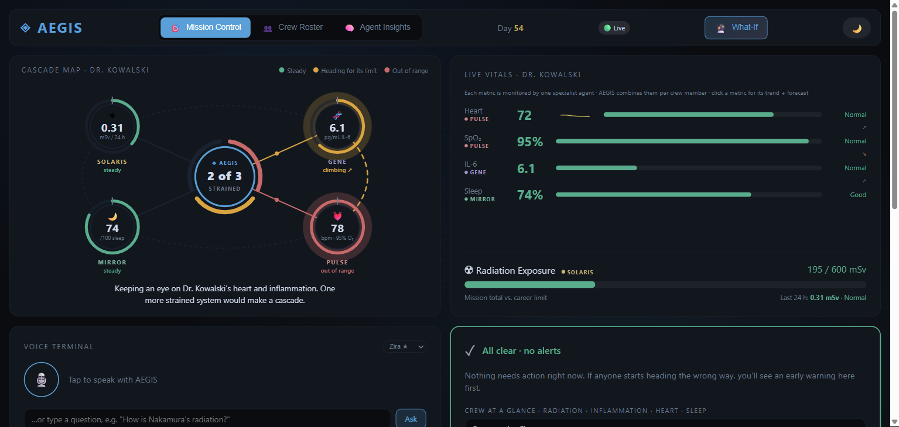
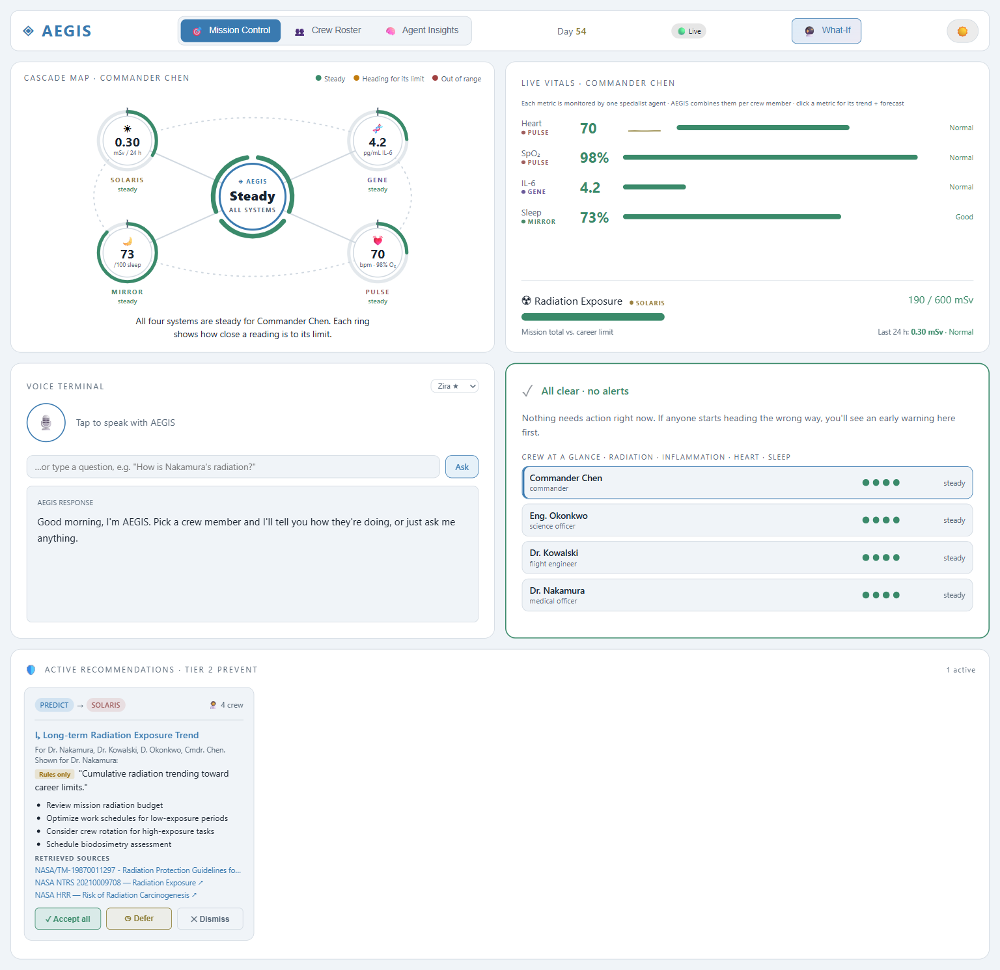

# AEGIS - Autonomous Expert Group for Integrated Space Health

**NASA Space Apps Challenge 2026 · Create Health Monitoring Software for Astronauts on Space Missions**

A multi-agent system that monitors crew health on deep-space missions, where help from Earth is minutes away.
Four specialist agents watch one area each, and AEGIS combines them to **predict** problems before they
happen, **prevent** them with early countermeasures, and **protect** the crew with emergency protocols.

> **Prototype, not a medical device.** Vitals come from a simulator (no wearable hardware is connected),
> IL-6 is modelled from stress and radiation, and nothing here is clinically validated. See
> `artifacts/AEGIS-Accuracy-Report.html` for how the rules and the AI were tested against real NASA data.

---

## Screenshots

**Early warning: AEGIS predicts a health cascade minutes before it happens**



The Cascade Map shows the four specialists around AEGIS. Each ring is how close a reading is to its agent's
limit; links glow when strain spreads between systems; the centre counts down to the moment three systems
are out of range together.

| Prevented: "Cascade avoided" | Emergency: medical alert and the on-call phone alarm |
|---|---|
|  | <br> |

| On board: the protocol carried out in the spacecraft | Dark mode |
|---|---|
|  |  |

<details>
<summary>Full dashboard</summary>



</details>

---

## The agents

| Agent | Watches | Raises |
|---|---|---|
| **AEGIS** | Combines the four specialists for each crew member | Predicted cascade (3+ systems heading out of range), cascade alert, protocol choice |
| **PULSE** | Heart rate, blood oxygen (SpO₂) | Fast/slow heart rate, low oxygen → medical response (MEDIC-1) |
| **GENE** | Inflammation signal (IL-6, modelled) | Raised inflammation |
| **MIRROR** | Sleep quality | Fair / poor sleep |
| **SOLARIS** | Radiation dose (24 h and mission total) | Elevated dose, solar storm → storm shelter (SHELTER-1) |

**The three pillars**

1. **PREDICT** - a least-squares trend over the last ~2 minutes of each reading forecasts when it will cross its
   agent's limit (`aegis_trends.py`). Three systems forecast to cross = an early cascade warning with a countdown.
2. **PREVENT** - a prevention plan (PREVENT-1) and rule-approved recommendations, worded by DeepSeek and
   grounded in NASA sources (RAG over ChromaDB).
3. **PROTECT** - live alerts with one-click protocols: RECOVER-3 (cascade), SHELTER-1 (radiation storm),
   MEDIC-1 (medical emergency), shown on board in the 2D spacecraft simulation.

**Keeping the AI honest** - the rules decide *when* to act; DeepSeek only explains and words the advice.
Every AI recommendation is fact-checked by `aegis_verify.py` (numbers, citations, approved actions, no
invented medicines) before it is shown; if it fails twice the card shows the rule-based advice instead.
Crew names are never sent to the model.

---

## Quick start (Windows)

### Prerequisites
- Python 3.10+ (3.13 used in development)
- Optional: [uv](https://docs.astral.sh/uv/getting-started/installation/)

### 1. Install

```powershell
cd path\to\project-horizons-AEGIS-nasa-apps-challeng
python -m venv .venv
.venv\Scripts\activate
pip install -r requirements.txt
```

(or `uv sync`)

### 2. Configure

```powershell
copy .env.example .env
```

Then edit `.env` (see [Configuration](#configuration)). Everything works without keys, using rule-based answers.

### 3. Start the backend

```powershell
$env:PYTHONUTF8 = "1"        # the startup log prints emoji; avoids a Windows console encoding error
uvicorn main:app --host 127.0.0.1 --port 8000
```

- API docs: http://127.0.0.1:8000/docs
- Health check: http://127.0.0.1:8000/health

The first start loads the embedding model and the knowledge base (about 20-40 s).

### 4. Serve the dashboard

In a second terminal:

```powershell
python -m http.server 8080 --bind 127.0.0.1
```

Open **http://127.0.0.1:8080/aegis-mission-control.html**. The header shows **🟢 Live** when the backend is
connected and **🔴 Offline** when it isn't. Click anywhere once so the browser allows the agents' voices.

### Demo shortcuts (on the dashboard)

| Keys | Scenario |
|---|---|
| **Shift + B** | Slow build-up for the selected crew member → early warning, countdown, then "Start prevention plan" |
| **Shift + D** | Cascade for the selected crew member → recovery plan |
| **Shift + M** | Medical emergency (low oxygen) for the selected crew member → medical response |
| **Shift + S** | Solar storm for the whole crew → storm shelter |
| **Shift + N** | Back to normal |

---

## Configuration

`.env` (never commit it; it is in `.gitignore`):

```bash
# DeepSeek: agents' explanations, Voice Terminal answers, RAG recommendations
DEEPSEEK_API_KEY=
DEEPSEEK_MODEL=deepseek-flash
# AEGIS_LLM=off               # force rule-based mode

# Phone alarm (optional, Twilio): AEGIS phones the on-call flight surgeon on critical alerts
TWILIO_ACCOUNT_SID=
TWILIO_AUTH_TOKEN=
TWILIO_FROM_NUMBER=           # your Twilio number, e.g. +1...
AEGIS_ONCALL_NUMBER=          # the phone to ring (on a trial account it must be verified)
# AEGIS_CALLS=off             # turn calls off without removing the keys
# AEGIS_CALL_COOLDOWN_MIN=10
# AEGIS_CALL_MAX_PER_HOUR=4
```

Without Twilio keys the alarm is logged ("would have called") instead of dialled. Test it with
`POST /api/notify/test` in the API docs.

---

## Project structure

```
project-horizons-AEGIS-nasa-apps-challeng/
├── main.py                       # FastAPI backend (all routes under /api)
├── agents.py                     # PULSE, GENE, MIRROR, SOLARIS + AEGIS coordinator
├── aegis_trends.py               # PREDICT: trends, time-to-limit forecasts, predicted cascade
├── aegis_llm.py                  # DeepSeek client (chat + tool calling), agent personas
├── aegis_verify.py               # Fact checker for AI output (numbers, citations, actions, medicines)
├── aegis_notify.py               # Phone alarm (Twilio voice call) + call_flight_surgeon tool
├── aegis_rag.py                  # Knowledge-base retrieval (ChromaDB, all-MiniLM-L6-v2)
├── simulator.py                  # Vitals simulator and demo scenarios
├── database.py                   # SQLite storage (aegis.db, created on first run)
├── models.py                     # Pydantic models
├── setup_chromadb.py             # Builds the knowledge base into chroma_db/
├── aegis-mission-control.html    # Dashboard (Cascade Map, vitals, voice terminal, alerts, recommendations)
├── aegis-api-client.js           # Dashboard ↔ backend client
├── aegis-spacecraft-sim-2d.html  # 2D spacecraft: protocols carried out on board
├── chroma_db/                    # Vector database (knowledge base)
├── data/
│   ├── aegis_knowledge_base.json # Countermeasures, protocols, medications
│   ├── nasa_hrr_risks.json       # NASA Human Research Roadmap risks
│   ├── AEGIS_SOURCES.md          # Cited sources
│   ├── hrp_docs/  live_feeds/  osdr_metadata/
│   └── real/                     # Inspiration4 blood data (NASA OSDR OSD-575/569) + NTRS abstracts
├── eval/                         # Accuracy evaluation (run_eval.py, results.json)
└── artifacts/                    # Reports: accuracy, test plan, improvements, architecture, solution brief
```

---

## Main API endpoints

All under `http://127.0.0.1:8000`. Full list and try-it-out at `/docs`.

| Method | Endpoint | What it does |
|---|---|---|
| GET | `/health` | Backend, simulator and AI status |
| GET | `/api/crew` · `/api/crew/{id}` | Crew members and live vitals |
| GET | `/api/crew/{id}/trends` | Trends and time-to-limit forecasts for one person |
| GET | `/api/predict` | Forecasts and predicted cascades for the whole crew |
| POST | `/api/crew/{id}/prevent` | Start the prevention plan |
| GET | `/api/recommendations/pending` | Open recommendations (with fact-check result) |
| POST | `/api/recommendations/{id}/action` | Accept, defer or dismiss |
| GET | `/api/alerts` · POST `/api/alerts/{id}/acknowledge` | Alerts and confirming a protocol |
| POST | `/api/ask` | Ask an agent a question (Voice Terminal) |
| POST | `/api/whatif` | Run the agents on hypothetical readings |
| POST | `/api/query` | Search the knowledge base |
| POST | `/api/simulation/scenario/{name}` | Demo scenarios (`buildup_demo`, `cascade_demo`, `medical_emergency`, `spe_event`, `nominal`) |
| GET | `/api/notify/status` · POST `/api/notify/test` | Phone alarm status and a test call |
| GET | `/api/llm/status` | DeepSeek status (never shows the key) |

---

## Accuracy evaluation

```powershell
python eval\run_eval.py            # rules vs real data + DeepSeek grounding (uses the API)
python eval\run_eval.py --no-llm   # rules vs real data only
```

It replays real Inspiration4 IL-6 values through GENE, measured ISS / Mars radiation through SOLARIS and
clinical cut-offs through PULSE, then measures how often DeepSeek's output is grounded and how many planted
hallucinations the fact checker catches. Results: `eval/results.json` and `artifacts/AEGIS-Accuracy-Report.html`.

Known gaps (documented in the report): SOLARIS's daily-dose thresholds are below normal deep-space background;
GENE's fixed IL-6 threshold misses the post-flight rise a personal baseline catches.

---

## Troubleshooting

- **Dashboard shows 🔴 Offline** - the backend isn't running on port 8000, or the page was opened as a file.
  Serve it over http (step 4).
- **`UnicodeEncodeError` on startup** - set `$env:PYTHONUTF8 = "1"` before starting the backend.
- **Port 8000 in use** - `netstat -ano | findstr :8000`, then `taskkill /PID <pid> /F`.
- **No voice** - click the page once (browsers block speech until you interact); pick a voice in the Voice
  Terminal if the list is empty.
- **Knowledge base errors** - rebuild it: `python setup_chromadb.py`.

---

## License

NASA Space Apps Challenge 2026 - open source.
